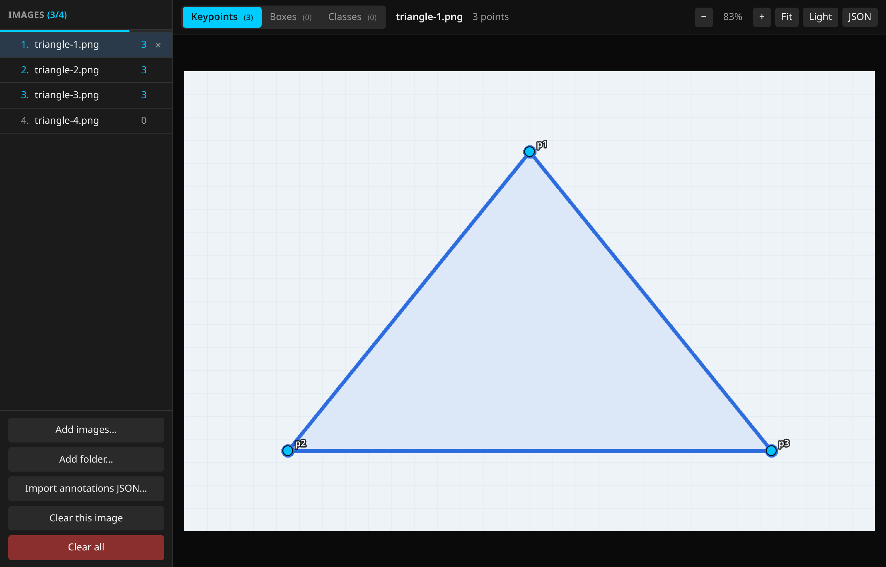

# Image Annotator

A simple **single-file HTML web app** — no build step, no dependencies — for annotating images with three modes: **keypoints**, **bounding boxes**, and **whole-image classification**. Everything runs locally; no image is uploaded to a server.

**Web app:** [image-annotator.surge.sh](https://image-annotator.surge.sh) — runs entirely in your browser.



## Features

### Three Modes
- **Keypoints** — click to place points; drag a point to fine-tune
- **Bounding boxes** — drag to draw a box, drag its body to move, resize with 8 handles
- **Classes** — tag the whole image; **single-label by default** (picking another label replaces the current one), with an optional **multi-label** toggle

### Switching Modes
- **Segmented control** — in the top bar; the mode is remembered across reloads and mirrored in the URL (`#keypoints`, `#boxes`, `#classes`) for deep links
- **Per-mode counts in the tabs** — `Keypoints (3)` is how many keypoints the **current image** has; `Boxes (2)` and `Classes (1)` show its boxes and labels, so you can see everything that image has at a glance. Dataset progress stays in the sidebar (`Images (i/n)`)

### Appearance
- **Light & dark** — follows your system/browser preference by default; the **Light/Dark** button in the top bar overrides it and the choice is remembered

### Labels
- **Shared label set** — define labels once; use them for boxes and whole-image classes
- **Per-box labels** — every box carries its own class, so two boxes on one image can be different things
- **Click or press `1…9`** to pick the active label (boxes) or set/toggle a class (classes)
- **Single or multi-label** — single by default (one click changes the class); tick **multi-label** in the label bar to allow several labels per image
- Add and remove labels inline in the label bar

### Image Loading
- **Drag & drop** — drop one or many images or a **whole folder** anywhere; a full-page overlay shows the drop zone, even when images are already loaded. Folders are scanned recursively (subfolders included)
- **Folder picker** — **Add folder…** opens the directory chooser for the same result
- **Remove from list** — click the `×` on a row (annotations are kept, so re-adding the file restores them)
- **No upload** — files are read locally with `URL.createObjectURL`

### Editing
- **Keypoints** — drag to move, arrow keys to nudge, right-click or <kbd>Del</kbd> to remove
- **Boxes** — drag to draw, drag the body to move, drag any handle to resize, right-click or <kbd>Del</kbd> to remove. Click a box to select it (yellow outline, tinted body, yellow label chip); click empty space or press <kbd>Esc</kbd> to deselect.
- **Overlapping boxes** — click again on the same spot to cycle through the stack, or <kbd>Alt</kbd>-click. The selected box is drawn on top.
- **Box list** — the sidebar lists every box on the current image (label + size); click a row to select it, `×` to delete. Useful when boxes overlap.
- **Zoom & pan** — scroll to zoom around the cursor, drag the background to pan, <kbd>F</kbd> to fit
- **Crisp at any zoom** — the canvas renders at screen resolution, so dots, boxes and labels stay sharp

### Progress
- Numbered file list (`1. name`, `2. name`, …)
- `Images (i/n)` and a progress bar, where *i* = images annotated **in the current mode**

### Persistence & Export
- **Per-mode auto-save** — `localStorage`, keyed by filename, so switching modes never mixes data
- **JSON panel** — shows the current mode's annotations; **Copy**, **Download**, **Select all**
- **Import** — drop an annotations `.json` anywhere, use **Import annotations JSON…** / **Import file…**, or paste and **Import from box**
- **Clear** — the current image's annotations, or all images (current mode only)

### Keyboard Shortcuts
| Key | Action |
|-----|--------|
| <kbd>1</kbd>…<kbd>9</kbd> | Select label (boxes) / set class (single) or toggle class (multi) |
| <kbd>Del</kbd> | Remove the selected point/box |
| <kbd>←</kbd> <kbd>↑</kbd> <kbd>↓</kbd> <kbd>→</kbd> | Nudge 1px |
| <kbd>Shift</kbd> + arrows | Nudge 10px |
| <kbd>F</kbd> | Fit the image to the window |
| <kbd>Esc</kbd> | Deselect |

## Usage

Open the web app: [https://image-annotator.surge.sh](https://image-annotator.surge.sh)

### Run locally

```bash
cd image-annotator
python3 -m http.server 8099
```

Open [http://localhost:8099](http://localhost:8099).

Try it with the [`demo/`](demo) folder of sample images — four triangles plus [`annotations.json`](demo/annotations.json). Adding the folder imports the annotations too: three triangles get the **same three keypoints** (`p1`, `p2`, `p3`) at their vertices, the fourth stays unmarked, so the sidebar reads **3 / 4**. Keeping the same keypoints in the same order across images is what makes a consistent keypoint dataset.

1. Drop images onto the page (or **Add images… / Add folder…**)
2. Pick a mode: **Keypoints**, **Boxes**, or **Classes**
3. Annotate, then open **JSON** and **Copy** or **Download**

### Host it

The tool is a single `index.html` with no build step. It is deployed on Surge:

```bash
surge . image-annotator.surge.sh
```

Any static host works too (GitHub Pages, Netlify, …) — just serve the folder.

> Serving over `http://` (rather than opening the file directly) gives `localStorage` a stable origin, so annotations persist reliably.

## Data Formats

The JSON panel always shows the **current mode**. Keys are filenames.

### Keypoints

```json
{
  "photo-1.jpg": [
    { "x": 493, "y": 863, "label": "p1" }
  ]
}
```

- **Array order is the keypoint order** (`p1`, `p2`, …). Use the same order and the same set of labels on every image to keep the dataset consistent.

### Boxes

```json
{
  "photo-1.jpg": [
    { "x": 120, "y": 80, "w": 240, "h": 180, "label": "cat" },
    { "x": 400, "y": 300, "w": 120, "h": 90, "label": "dog" }
  ]
}
```

- `x`, `y` = top-left corner; `w`, `h` = size, in image pixels

### Classes

```json
{
  "photo-1.jpg": { "labels": ["cat", "indoor"] }
}
```

- **Single-label by default** — picking another label replaces it; enable **multi-label** in the label bar for multiple findings on one image
- Images with no annotations are omitted

## Notes

- Annotations live in this browser's `localStorage`, one key per mode: `keypoint-annotator-v1` (kept from the original keypoint-only version), `image-annotator:boxes`, `image-annotator:classes`, plus `image-annotator:labels`, `image-annotator:mode`, `image-annotator:multi` and `image-annotator:theme`.
- Clearing site data clears annotations — download the JSON to keep a copy.
- Images are not persisted (browser security); only annotations are. Re-drop the same files and they reappear by filename.
- Same-filename images in different folders share a key, so keep filenames unique when annotating across folders.
- Import replaces the annotations for each filename present in the JSON; other images are kept.

## Technical Details

- Single static `index.html` — no build step, no dependencies
- Canvas 2D; pointer events for draw / move / resize / pan
- The canvas is sized to the viewport × `devicePixelRatio` and redrawn through a 2D transform on every zoom/pan, so annotations stay crisp at any zoom
- Click coordinates map through the same transform, so they stay exact at any scale
- Full-page `dragenter` / `dragover` / `drop` handlers with `preventDefault()`, so the browser never opens a dropped file
- Folder drop uses the standard `webkitGetAsEntry` API (Chromium, Firefox, Safari); tested in Chromium
- No dependencies, no build, no backend — the whole app is `index.html`

## License

This project is licensed with [BSD-2-Clause](./LICENSE)

This is free, libre, and open-source software. It comes down to four essential freedoms [[ref]](https://seirdy.one/2021/01/27/whatsapp-and-the-domestication-of-users.html#fnref:2):

- The freedom to run the program as you wish, for any purpose
- The freedom to study how the program works, and change it so it does your computing as you wish
- The freedom to redistribute copies so you can help others
- The freedom to distribute copies of your modified versions to others
